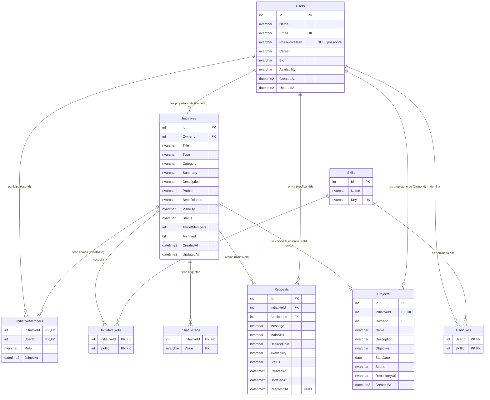

# Modelo de datos (MongoDB)

Implementado con Mongoose en `servidor/src/models/`. Seis colecciones. La regla que se aplicó para decidir **embebido o referencia**:

- **Embeber** cuando el dato es pequeño, acotado, se lee siempre junto con su padre y no tiene vida propia.
- **Referenciar** cuando el dato crece sin límite, se consulta desde varios lados, se comparte entre documentos o tiene ciclo de vida propio.

```
users ──┬─────────────< user.skills[] >──────────┐
        │                                         ▼
        │                                      skills
        │                                         ▲
        ├── owner ──> initiatives ── skills[] ────┘
        │               │  └─ members[] (EMBEBIDO: { user→users, role, joinedAt })
        │               │
        ├── applicant ─> requests ── initiative ──> initiatives
        │
        └── owner ────> projects ─── initiative ──> initiatives (única)

sessions ── user ──> users
```

## Colecciones

| Colección | Campos principales | Índices |
|---|---|---|
| `users` | `name`, `email` (único), `passwordHash`, `career`, `bio`, `availability`, `skills[]` (ref) | `email` único, `name`, `skills` |
| `skills` | `name`, `key` (nombre normalizado, único) | `key` único |
| `sessions` | `tokenHash`, `user` (ref), `expiresAt` | `tokenHash` único, TTL sobre `expiresAt` |
| `initiatives` | `owner` (ref), `title`, `type`, `category`, `summary`, `description`, `problem`, `beneficiaries`, `tags[]`, `visibility`, `status`, `targetMembers`, `skills[]` (ref), `members[]` (embebido), `archived` | `owner`, `archived`, `members.user`, `skills`, `(type, category, createdAt)` |
| `requests` | `initiative` (ref), `applicant` (ref), `message`, `mainSkill`, `desiredRole`, `availability`, `status`, `resolvedAt` | `initiative`, `applicant`, único parcial `(initiative, applicant)` cuando `status = pendiente` |
| `projects` | `initiative` (ref, única), `owner` (ref), `name`, `description`, `objective`, `startDate`, `status`, `repositoryUrl` | `initiative` único, `owner` |

## Decisiones de embebido frente a referencia

| Relación | Decisión | Por qué | Costo / alternativa descartada |
|---|---|---|---|
| **Usuario ↔ competencia** (N:M) | **Referencia**: `users.skills[]` apunta a `skills` | La competencia es un concepto compartido entre usuarios e iniciativas. Con una colección propia se evita "SQL", "sql" y "Sql" como valores distintos y se puede filtrar por competencia con un índice. | Embeber el texto en cada usuario duplicaría información y haría imposible renombrar o normalizar. Se paga con una lectura extra (`populate`). |
| **Iniciativa ↔ competencia** (N:M) | **Referencia**: `initiatives.skills[]` apunta a `skills` | Misma razón; además la iniciativa y el usuario comparten el mismo catálogo, que es lo que permite decir "personas con la competencia que esta iniciativa necesita". | Igual que arriba. |
| **Iniciativa → propietario** (N:1, RN-01) | **Referencia**: `owner` | El usuario existe de forma independiente y se consulta por separado ("mis iniciativas"). | Embeber el nombre congelaría datos que cambian. |
| **Iniciativa → equipo** (1:N acotado) | **Embebido**: `members[]` con `{ user (ref), role, joinedAt }` | El equipo está acotado (`targetMembers` ≤ 20), siempre se lee junto con la iniciativa, y RN-09/RN-10 necesitan contarlo sin otra consulta. Cada miembro **referencia** al usuario para no duplicar su nombre. | Una colección `members` obligaría a un `$lookup` en cada detalle y en cada conteo. Se paga con un índice multillave `members.user` para "mis equipos". |
| **Iniciativa → solicitudes** (1:N sin límite) | **Referencia**: colección `requests` | Crecen sin límite, tienen estados y ciclo de vida propios (pendiente → aceptada…), y se consultan por dos lados: el solicitante ("mis solicitudes") y el propietario ("recibidas"). Embebidas habría que recorrer todas las iniciativas para listar las de una persona. | La unicidad "una pendiente por persona e iniciativa" se resuelve con un índice único parcial. |
| **Proyecto → iniciativa** (1:1) | **Referencia única**: `projects.initiative` | El proyecto conserva la referencia a su origen. Es único por iniciativa y tiene sus propios atributos. | **No se copia el equipo**: los miembros del proyecto se leen de la iniciativa, así no hay dos listas que mantener sincronizadas. |
| **Sesión → usuario** | **Referencia** + TTL | Las sesiones nacen y mueren independientemente del usuario; MongoDB las expira solo. | Se guarda el hash del token, no el token. |

## Reglas que el modelo ayuda a garantizar

- **RN-01**: `owner` es obligatorio y no hay endpoint que lo modifique. El propietario también está en `members` con `role = propietario`.
- **RN-05**: índice único parcial en `requests` impide dos solicitudes pendientes iguales aunque lleguen dos peticiones simultáneas.
- **RN-08**: aceptar = cambio de estado condicionado (`status = pendiente`) + `$push` condicionado a que el usuario no esté ya en `members`.
- **RN-09**: `members.length >= 2` en la iniciativa; `projects.initiative` único impide convertir dos veces.
- **RN-10**: `archived` en la iniciativa; se archiva si tiene `members.length > 1`, solicitudes o proyecto.

## Cómo se retomará en la entrega final (modelo relacional)

| MongoDB | Tablas |
|---|---|
| `skills` + `users.skills[]` + `initiatives.skills[]` | `skills`, `user_skills(user_id, skill_id)`, `initiative_skills(initiative_id, skill_id)` |
| `initiatives.members[]` embebido | `initiative_members(initiative_id, user_id, role, joined_at)` |
| `requests`, `projects`, `sessions` | Tablas con llaves foráneas; índice único parcial → `UNIQUE` filtrado (o validación + transacción) |
| Ids `ObjectId` | Ids enteros o UUID (la API ya los trata como cadenas opacas) |
| Arreglo `tags[]` | Tabla `initiative_tags` o columna JSON |

Lo más costoso de portar es el equipo embebido (pasa a tabla intermedia) y la atomicidad de aceptar una solicitud (pasa a transacción).
## Modelo relacional

Segunda parte del modelo: cómo el dominio, que en el Avance 2 vivía en seis colecciones de MongoDB, queda en tablas de SQL Server mediante Entity Framework Core 10.
El contrato de la API (`docs/api-contract.md`) no cambia: los ids siguen viéndose como texto y las competencias como listas de nombres.

> La tabla `sessions` (sesiones con TTL) se deja fuera de esta entrega porque la autenticación se implementa en la entrega final. Por eso `users.PasswordHash` es nulo por ahora.

### Diagrama entidad-relación



### Tablas

Los largos de `nvarchar` coinciden con los `maxlength` de los modelos Mongoose. Todas las columnas son obligatorias salvo las marcadas como NULL.

#### Users

| Columna | Tipo | Obligatoria | Notas |
|---|---|---|---|
| Id | int identity | Sí | PK |
| Name | nvarchar(80) | Sí | |
| Email | nvarchar(120) | Sí | **Índice único** |
| PasswordHash | nvarchar(100) | No (NULL) | Se vuelve obligatoria con la autenticación |
| Career | nvarchar(80) | Sí | Por defecto vacío |
| Bio | nvarchar(400) | Sí | Por defecto vacío |
| Availability | nvarchar(5) | Sí | **CHECK** `IN ('alta','media','baja')` |
| CreatedAt, UpdatedAt | datetime2 | Sí | Por defecto `SYSUTCDATETIME()` |

Índices: único en `Email`; normal en `Name`.

#### Skills

| Columna | Tipo | Obligatoria | Notas |
|---|---|---|---|
| Id | int identity | Sí | PK |
| Name | nvarchar(60) | Sí | Texto tal como se muestra |
| Key | nvarchar(60) | Sí | Nombre normalizado (minúsculas, sin tildes). **Índice único** |

#### UserSkills (tabla intermedia sin clase)

| Columna | Tipo | Notas |
|---|---|---|
| UserId | int | PK compuesta y FK a Users |
| SkillId | int | PK compuesta y FK a Skills |

#### Initiatives

| Columna | Tipo | Obligatoria | Notas |
|---|---|---|---|
| Id | int identity | Sí | PK |
| OwnerId | int | Sí | FK a Users (RN-01) |
| Title | nvarchar(120) | Sí | |
| Type | nvarchar(10) | Sí | **CHECK** `IN ('idea','necesidad','reto')` |
| Category | nvarchar(30) | Sí | **CHECK** con las 8 categorías del contrato |
| Summary | nvarchar(160) | Sí | |
| Description | nvarchar(4000) | Sí | |
| Problem | nvarchar(1500) | Sí | Vacío si no se indica |
| Beneficiaries | nvarchar(300) | Sí | Vacío si no se indica |
| Visibility | nvarchar(15) | Sí | **CHECK** `IN ('publica','institucional','restringida','privada')` (RN-03) |
| Status | nvarchar(20) | Sí | **CHECK** `IN ('buscando-equipo','en-progreso','pausada','completada')` |
| TargetMembers | int | Sí | **CHECK** `BETWEEN 1 AND 20` |
| Archived | bit | Sí | RN-10 |
| CreatedAt, UpdatedAt | datetime2 | Sí | |

Índices: `OwnerId`, `Archived` y `(Type, Category, CreatedAt)`.

#### InitiativeSkills (tabla intermedia sin clase)

| Columna | Tipo | Notas |
|---|---|---|
| InitiativeId | int | PK compuesta y FK a Initiatives |
| SkillId | int | PK compuesta y FK a Skills |

#### InitiativeTags

| Columna | Tipo | Notas |
|---|---|---|
| InitiativeId | int | PK compuesta y FK a Initiatives |
| Value | nvarchar(40) | PK compuesta: una etiqueta no se repite en la misma iniciativa |

#### InitiativeMembers (entidad intermedia)

| Columna | Tipo | Obligatoria | Notas |
|---|---|---|---|
| InitiativeId | int | Sí | PK compuesta y FK a Initiatives |
| UserId | int | Sí | PK compuesta y FK a Users. Índice por `UserId` para "mis equipos" |
| Role | nvarchar(11) | Sí | **CHECK** `IN ('propietario','miembro')` |
| JoinedAt | datetime2 | Sí | |

#### Requests

| Columna | Tipo | Obligatoria | Notas |
|---|---|---|---|
| Id | int identity | Sí | PK |
| InitiativeId | int | Sí | FK a Initiatives. Índice |
| ApplicantId | int | Sí | FK a Users. Índice |
| Message | nvarchar(600) | Sí | |
| MainSkill | nvarchar(60) | Sí | |
| DesiredRole | nvarchar(80) | Sí | |
| Availability | nvarchar(5) | Sí | **CHECK** `IN ('alta','media','baja')` |
| Status | nvarchar(10) | Sí | **CHECK** `IN ('pendiente','aceptada','rechazada','cancelada')` |
| CreatedAt, UpdatedAt | datetime2 | Sí | |
| ResolvedAt | datetime2 | No (NULL) | |

Índice único **filtrado** `(InitiativeId, ApplicantId) WHERE Status = 'pendiente'` (RN-05): reemplaza al índice único parcial de MongoDB.

#### Projects

| Columna | Tipo | Obligatoria | Notas |
|---|---|---|---|
| Id | int identity | Sí | PK |
| InitiativeId | int | Sí | FK a Initiatives, **índice único** (RN-09: una conversión como máximo) |
| OwnerId | int | Sí | FK a Users. Índice |
| Name | nvarchar(120) | Sí | |
| Description | nvarchar(2000) | Sí | |
| Objective | nvarchar(500) | Sí | |
| StartDate | date | Sí | |
| Status | nvarchar(13) | Sí | **CHECK** `IN ('planificacion','activo','finalizado')` |
| RepositoryUrl | nvarchar(200) | Sí | Cadena vacía si no hay repositorio |
| CreatedAt | datetime2 | Sí | |

### Relaciones

| Relación | Cardinalidad | Cómo se resuelve |
|---|---|---|
| usuario–competencia | muchos a muchos | Tabla intermedia **sin clase** `UserSkills (UserId, SkillId)`: no tiene datos propios |
| usuario–iniciativa (propietario) | uno a muchos | Clave foránea `Initiatives.OwnerId` |
| usuario–iniciativa (equipo) | muchos a muchos con datos propios | **Entidad intermedia** `InitiativeMembers` con `Role` y `JoinedAt` |
| iniciativa–competencia | muchos a muchos | Tabla intermedia **sin clase** `InitiativeSkills (InitiativeId, SkillId)` |
| iniciativa–solicitud | uno a muchos | Clave foránea `Requests.InitiativeId` |
| usuario–solicitud (solicitante) | uno a muchos | Clave foránea `Requests.ApplicantId` |
| proyecto–usuario (propietario) | uno a muchos | Clave foránea `Projects.OwnerId`. El equipo del proyecto **no se copia**: se lee de `InitiativeMembers` de su iniciativa |
| proyecto–iniciativa | uno a uno (la iniciativa puede no tener proyecto) | Clave foránea `Projects.InitiativeId` con índice único |
| iniciativa–etiqueta | uno a muchos | `InitiativeTags` con clave foránea a la iniciativa |

### Comportamiento al borrar

| Clave foránea | Comportamiento | Justificación |
|---|---|---|
| Initiatives.OwnerId → Users | **Restrict** | Una iniciativa siempre tiene propietario (RN-01); no se borra a un usuario que es propietario |
| InitiativeMembers.InitiativeId → Initiatives | **Cascade** | El equipo no tiene vida propia fuera de su iniciativa |
| InitiativeMembers.UserId → Users | **Restrict** | Evita borrar a una persona que forma parte de un equipo y, además, evita rutas de borrado en cascada múltiples en SQL Server |
| InitiativeTags.InitiativeId → Initiatives | **Cascade** | Las etiquetas son parte de la iniciativa |
| UserSkills.UserId → Users | **Cascade** | Al borrar un usuario desaparecen sus competencias, no el catálogo |
| UserSkills.SkillId → Skills | **Restrict** | No se borra una competencia que alguien usa |
| InitiativeSkills.InitiativeId → Initiatives | **Cascade** | Las competencias requeridas son parte de la iniciativa |
| InitiativeSkills.SkillId → Skills | **Restrict** | No se borra una competencia que una iniciativa necesita |
| Requests.InitiativeId → Initiatives | **Restrict** | Las solicitudes son historial; si existen, RN-10 manda archivar en lugar de eliminar |
| Requests.ApplicantId → Users | **Restrict** | No se pierde el historial de solicitudes |
| Projects.InitiativeId → Initiatives | **Restrict** | Con proyecto asociado la iniciativa se archiva, no se elimina (RN-10) |
| Projects.OwnerId → Users | **Restrict** | El propietario de un proyecto no se borra |

### Del documento a la tabla

| Colección o arreglo del Avance 2 | Cómo quedó | Por qué |
|---|---|---|
| `users` | Tabla `Users` | Mismas columnas; `email` con índice único; la contraseña queda nula hasta la autenticación |
| `users.skills[]` (referencias) | Tabla intermedia `UserSkills` | Es muchos a muchos sin datos propios: basta la tabla sin clase. Se elimina el arreglo de ids |
| `skills` | Tabla `Skills` | La columna `Key` conserva la normalización y su índice único |
| `initiatives` | Tabla `Initiatives` | Mismos campos; `owner` pasa a ser la clave foránea `OwnerId`; se agregan CHECK para los valores fijos |
| `initiatives.skills[]` (referencias) | Tabla intermedia `InitiativeSkills` | Igual que `UserSkills`; ambas comparten el catálogo `Skills` |
| `initiatives.tags[]` (arreglo de textos) | Tabla `InitiativeTags` | Es un arreglo de valores simples que no se consulta desde otro lado; una fila por etiqueta evita un JSON y permite filtrar con SQL |
| `initiatives.members[]` (embebido) | Entidad intermedia `InitiativeMembers` | Es lo más costoso de portar: era un arreglo dentro del documento, ahora es una relación muchos a muchos con datos propios (`Role`, `JoinedAt`), por eso necesita clase |
| `requests` | Tabla `Requests` | La colección ya era aparte; las referencias pasan a claves foráneas. El índice único parcial pasa a índice único filtrado por `Status = 'pendiente'` |
| `projects` | Tabla `Projects` | `initiative` pasa a clave foránea con índice único (1 a 1). No se duplica el equipo |
| `sessions` | **No se migra en esta entrega** | Depende de la autenticación, que se implementa en la entrega final. Se creará con `TokenHash` único y fecha de expiración; el TTL de MongoDB se reemplazará por una limpieza periódica |
| `ObjectId` | `int identity` | La API trata los ids como texto opaco: se devuelven con `ToString()`, el contrato no cambia |
